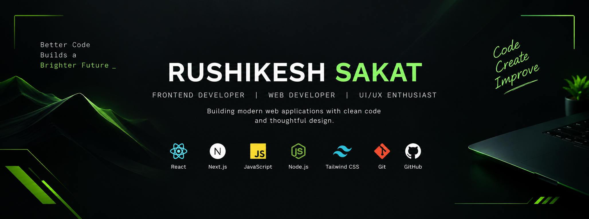

  

 

## About Me

I'm a web developer passionate about creating intuitive interfaces,
responsive websites, and practical digital products.

- Developing with React, Next.js, and JavaScript.
- Building interactive user interfaces and web applications.
- Exploring backend development, APIs, and deployment.
- Improving my skills through hands-on projects.
- Open to collaboration and freelance opportunities.

## Tech Stack

### Frontend

### Backend & Tools

## Featured Projects

### 01 — CodeCast
**Real-Time Collaborative Code Editor**

A collaborative coding platform designed to let multiple users
work together in a shared coding environment.

- Real-time synchronization with Socket.IO
- Room-based collaboration
- Code editing with CodeMirror

**Stack:** React · Node.js · Socket.IO · CodeMirror

[Explore my repositories →](https://github.com/rushikesh47-del?tab=repositories)

### 02 — URU
**IT Solutions & SaaS**

A digital technology brand focused on professional websites,
web applications, and digital experiences for businesses.

- Responsive web development
- Modern UI and interactive animations
- Business-focused digital solutions

**Stack:** Next.js · React · Tailwind CSS · GSAP

[Explore my repositories →](https://github.com/rushikesh47-del?tab=repositories)

### 03 — Morrow
**Web Application**

A web application project focused on authentication,
user experience, and backend integration.

**Stack:** JavaScript · Node.js · Express · Firebase

[Explore my repositories →](https://github.com/rushikesh47-del?tab=repositories)

## GitHub Overview

## Let's Connect

- **GitHub:** [rushikesh47-del](https://github.com/rushikesh47-del)
- **Portfolio:** https://new-portfolio-nine-drab.vercel.app/
- **LinkedIn:** www.linkedin.com/in/rushikesh-sakat
- **Company URL:** https://uru-nine.vercel.app/
- **Email:**

---

*Learning continuously. Building thoughtfully. Improving every day.*

